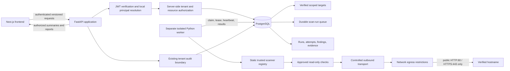

# Phase 3 architecture, security threat model, and implementation blueprint

## Status and scope

The product owner has approved the nine architecture decisions listed near the end of this
document and formally signed off and closed Phase 3A. Overall Phase 3B status is **IN PROGRESS —
engineering foundations implemented; formal closure pending**. The acceptance status of each
Phase 3B milestone is recorded in the unresolved-decision map below. Phase 3B.3 implements
server-side DNS TXT verification for organization targets, including atomic one-time challenge
consumption and `verified_at` updates; this is a service capability, not a public target operation.
Phase 3B.4.1–3 implement the IP destination policy, immutable DNS-resolution models, and dual-stack
DNS resolver. Phase 3B.4.4 implements the pinned HTTP/TLS transport. Public target API routes,
scanner execution, queues, and workers are not implemented. Security acceptance and production-
provider egress review remain outstanding; implementation and fixture-based tests do not establish
production readiness.

**Policy v1 approved and implementation authorized on 2026-11-24.**
The project owner approved IP Destination Policy v1 on `2026-11-24`. The first implementation
deliverable now exists: authoritative IANA CSV snapshots, a versioned normalized policy artifact,
a pure address-classification module, and tests. That policy deliverable did not itself implement
DNS A/AAAA resolution or outbound execution; those capabilities are now implemented separately
under Phase 3B.4.

**Not implemented:** public target routes, scanner execution, queue/worker functionality, and
production deployment configuration. The approved Phase 3B.4 implementation does not change TXT
resolver configured-nameserver behavior or dnspython exception handling. Security acceptance and
production-provider egress review are still required before production deployment. The canonical
resolver and transport requirements remain specified in the
[DNS A/AAAA resolution proposal](#dns-aaaa-resolution-proposal) and
[Explicit IPv4/IPv6 policy](#explicit-ipv4ipv6-policy) sections below.

The design preserves the Phase 2 identity, tenancy, authorization, audit, lifecycle, and scan-record
foundations. It keeps the backend a modular monolith, adds a separately run Python worker, uses
PostgreSQL as the initial durable queue, and limits initial scanning to read-only checks against
verified exact hostnames on HTTP port 80 and HTTPS port 443.

### A. Current-state architecture

The repository is a pnpm/uv monorepo:

- `apps/web` is a Next.js App Router application with TypeScript. It currently provides a static
  landing page and has no authentication flow, API client, or scan workflow.
- `apps/api` is a FastAPI application using Pydantic, SQLAlchemy 2.x, and Alembic. It contains
  modular identity, tenancy, scans, and audit foundations.
- PostgreSQL is the architectural database and is used by local Docker Compose and CI integration
  tests. There is no selected production database provider or production deployment.
- The repository includes Vitest, Pytest, Playwright, and a separate PostgreSQL integration-test
  path.

Implemented Phase 2 capabilities include configured JWT access-token verification, local identity
resolution, active-account checks, personal and organization scopes, organization membership and
role authorization, organization/account lifecycle operations, scan-record persistence, explicit
unit-of-work transactions, PostgreSQL concurrency validation, and durable database audit events.
These are application foundations, not a production security certification or deployed control
plane.

The `security_scans` table and protected scan routes currently create, list, and retrieve records
within personal or organization scope. A scan-create request has no target or execution options;
the record has no run state, findings, or evidence. **Existing scan creation is persistence only:
it does not make a network request or perform a scan.** No public target API, HTTP scanner, scanner
registry, queue, worker, progress/cancellation API, finding analysis, report, or scan-result UI is
implemented. A server-side Phase 3B.3 organization-target DNS TXT verification service now exists,
but it is not exposed by a route or combined with target-address resolution or execution.

Phase 2 organization scan-record permissions remain unchanged: OWNER, ADMIN, and MEMBER may create
records; all four roles, including VIEWER, may read/list records. Phase 3 target management,
execution, findings, normalized evidence, and cancellation are new resources with the distinct
approved permission matrix in section G. That future matrix does not retroactively alter the Phase 2
record API.

See the [architecture overview](./overview.md), [Phase 2 roadmap](./phase-2-roadmap.md), and
[architecture decisions](./decisions.md) for implemented foundations and their limits.

### B. Target architecture and trust boundaries



Component responsibilities:

- **Next.js frontend:** collect a target and scan request, present authorization-safe lifecycle
  states and results, and display only evidence the signed-in user may see. The UI is not an
  authorization boundary.
- **FastAPI application:** authenticate the caller; authorize every operation using current local
  identity, organization, membership, role, resource scope, and target-verification state; validate
  requests; persist a scan request and its queueable run atomically; expose scoped status and
  results. It must not perform long-running network scanning in the request process.
- **PostgreSQL:** hold tenant-scoped targets and verification state, scan records, run lifecycle,
  attempts, normalized findings/evidence, audit events, quotas, and durable queue state.
- **Python worker:** claim server-created work, enforce leases and bounded execution, invoke only
  registered trusted modules, emit bounded typed output, and persist results. It has no public
  listener and does not receive user bearer credentials. Its database identity must not perform
  identity-management or privileged account operations, modify organization membership or roles,
  create arbitrary tenant jobs, or modify authorization state. It may access only the job and
  operational records needed for work assigned by server-created jobs; tenant and run scope must
  be established by those jobs and validated again when persisting output. Exact SQL grants and
  their implementation are deferred to 3C/3D.
- **Static scanner registry:** select only built-in, versioned scanner implementations. No runtime
  imports, uploaded plugins, shell execution, or user-supplied scanner code.
- **Outbound transport and network controls:** enforce exact target host, validated/pinned
  destination address, permitted scheme/port, TLS/SNI validation, no automatic redirects, and hard
  resource limits. A network firewall/egress policy is a separate defense from application checks.
- **Results/reporting:** APIs return a finding summary or detailed normalized evidence only after
  authorization. Reports are derived from persisted, versioned results; no third-party reporting or
  paid service is required.

Trust boundaries exist between browser input and the API; verified identity and local authorization;
the API and worker queue; worker code and untrusted DNS/target responses; and the worker's
application-level network policy and the deployment's network egress controls. Database locks are
for short state transitions only; they must never be held across DNS, TLS, or HTTP operations.

### C. Target verification and outbound security

#### DNS TXT verification lifecycle

1. An authenticated caller requests a target under a personal scope or an organization scope. The
   server canonicalizes the input as a hostname, not a URL. An organization target can be created
   or managed only by OWNER or ADMIN; a personal target is managed only by its owner.
2. The server generates an unpredictable, single-use challenge with at least 256 bits of
   cryptographic randomness. It returns the value once, with instructions to publish a TXT record
   at a dedicated name such as `_threatsentinel-verification.<exact-hostname>`. The challenge value
   is never logged.
3. Persist only a cryptographic hash (or keyed HMAC) of the challenge, target and actor/scope
   identifiers, issue time, and bounded expiry. Do not persist the raw challenge or return it again
   after the initial issuance response. Rate-limit issuance and verification; invalidate superseded
   challenges.
4. An explicit verification operation queries TXT records using a bounded resolver. Accept only an
   exact challenge match for the requested exact hostname and unexpired challenge. On success,
   atomically consume the challenge and record verification time. The current target model does not
   persist the verification method or policy version.
5. Verification is scope-bound. An organization member cannot reuse a personal target's
   verification or transfer it across organizations. A subdomain requires its own separate
   challenge. Wildcards and IP-address targets are not accepted.
6. Verification expires or can be revoked. Before admission and again before execution, require a
   currently verified target. If a target is no longer authorized/verified, fail closed and do not
   connect. A target's ownership proof establishes control at verification time; it does not prove
   that a resolved IP is safe to contact.

Hostname canonicalization is implemented in Phase 3B.1 with the Python `idna` library using UTS #46
non-transitional processing and STD3 ASCII rules, including Unicode normalization and A-label/
U-label round-trip validation. It returns lowercase ASCII A-labels, removes one optional trailing
DNS root dot, and enforces a 253-octet hostname limit, 63-octet label limits, and at least two
non-empty labels. It rejects surrounding or embedded whitespace, URLs and their components, IP
literals and identifiable alternate numeric IP forms, wildcards, malformed separators, and
invalid IDNA labels. It does not trim or repair malformed input. This is syntactic canonicalization
only: it does not prove DNS resolution, public address status, ownership, authorization, or
permission to scan. Phase 3B.1 is ACCEPTED WITH FOLLOW-UP.

**Phase 3B.3 implementation:** For organization targets, the server queries the exact absolute owner
`_threatsentinel-verification.<canonical-hostname>.` using dnspython and the system-configured
recursive resolver. It validates the configured numeric nameserver addresses and tries them in
configured order. Each query has a 3-second budget, further bounded by the overall lookup deadline.
A UDP transport or DNS parsing exception (`dns.exception.DNSException`, `OSError`, or
`TimeoutError`) advances to the next configured nameserver only while query budget remains. A
truncated UDP reply receives exactly one TCP retry against that same nameserver within the
remaining query budget; a TCP transport or DNS parsing exception advances to the next configured
nameserver, where the query starts again over UDP, if budget remains.

A DNS response returned by the transport is passed to response validation; response validation
failures do not trigger nameserver fallback. This includes non-NOERROR outcomes such as NXDOMAIN,
SERVFAIL, and REFUSED; empty/NODATA answers; still-truncated TCP responses; mismatched IDs or
questions; and unsupported or unexpected response sections. A wire-format parsing failure raised by
dnspython during the transport call is instead a caught DNS parsing exception and can advance to the
next nameserver. The complete CNAME/TXT lookup is limited to 10 seconds and CNAME traversal to 8
links. Responses over 64 KiB, with more than 128 resource records across all sections, unsupported
classes/types in the answer, malformed or unexpected answers, unresolved truncation, loops, timeouts,
or other resolver errors fail closed. Authority and additional records count toward message-size
and record-count limits but are not used to establish the TXT proof.

TXT character-string chunks are concatenated only within their individual TXT record; each record's
bytes are independently SHA-256 hashed and compared with the persisted challenge hash. No case
folding, whitespace normalization, substring matching, or combination of distinct TXT records is
used. Challenge values and DNS answer contents are not logged or persisted.

The service reads the target and active challenge hash in a short authorized transaction, resolves
DNS without a database transaction or target lock, then revalidates membership, target scope and
eligibility, challenge identity/hash, and expiry in a new transaction. It atomically consumes the
challenge and sets `verified_at`; rotation, revocation, expiry, or a concurrent successful attempt
invalidates the pending verification. OWNER/ADMIN are the only authorized organization actors.
This Phase 3B.3 service does not expose a public target route or rate limiter, perform
A/AAAA target-address validation itself, issue HTTP requests, or run a scanner. Target
verification expiry/reverification policy remains open.

#### Phase 3B.4 DNS address resolution and outbound security

**Approved scope retained from Phase 3A.** The implementation is limited to resolving a verified
exact hostname, validating A and AAAA answers, and providing a one-shot pinned HTTP/HTTPS transport.
It does not add scanner checks, queue claims, workers, result storage, redirect following, arbitrary
ports, arbitrary paths or headers, scanning UI, or target APIs. HTTP is 80 and HTTPS is 443 only;
methods remain GET/HEAD, origin-root only, read-only and without credentials, cookies or
user-controlled headers.

##### Recommended architecture and data flow

1. The future executor resolves the canonical target hostname again at connection time. TXT
   ownership verification and address resolution are separate: a successful TXT proof does not
   authorize an address discovered later.
2. The address resolver performs a complete A and AAAA resolution through the system-configured
   recursive resolver, using only numeric nameserver addresses. It validates both families, both
   terminal answer sets and every CNAME hop. No socket connection occurs during or after this step
   until the complete result passes IP policy.
3. The resolver returns an immutable `ValidatedResolution` containing canonical hostname, ordered
   terminal IPv4 and IPv6 addresses, canonical CNAME chain, resolution status, resolution and
   total-deadline timestamps, and the exact policy version. It must contain no TXT challenge,
   resolver response, raw DNS bytes or internal resolver exception.
4. A one-shot pinned transport consumes that object. It creates a new socket for one candidate
   address only, with no hostname lookup in `socket`, `socketpair`, HTTP library or proxy layer.
   The candidate is selected solely from the validated set. A transport retry may use another
   candidate from the same immutable set, but it must not trigger a new DNS lookup or replace the
   set. TLS SNI remains the canonical hostname while the socket is pinned to the selected IP.
5. The future worker and scanner consume the transport through a narrow interface. The transport
   rejects method, scheme, port, path, header or redirect parameters outside the approved registry
   and context; it never accepts caller-supplied proxies or destination IPs.

Recommended module boundaries:

- `modules/networking/dns_address.py`: dnspython DNS message handling, CNAME chains, nameserver
  fallback, answer consistency, deadlines and response limits.
- `modules/networking/ip_policy.py`: versioned explicit IPv4/IPv6 allow-deny policy and
  auditable classification outcome.
- `modules/networking/pinned_http.py`: one-shot HTTP/1.1 and TLS socket/transport, Host/SNI,
  proxy isolation, size, framing and deadline enforcement.
- `modules/networking/types.py`: immutable resolution, address and bounded response data structures
  plus generic public failure classifications.
- `modules/targets/address_service.py` or an equivalent target-facing orchestration service:
  authorization revalidation and a fresh call to address resolution immediately before a connection.

The DNS resolver is transport-independent and testable. The IP policy is independent from dnspython.
The outbound transport must not know database, organization or challenge state. It receives only an
authorized canonical hostname and an already validated resolution. This keeps tenant authorization
and network policy in separate layers.

**Phase 3B.4 threat scenarios**

| Threat / scenario | Proposed mitigation | Residual risk |
|---|---|---|
| Tenant probes an internal hostname or later rebinds it to an internal address | TXT verification and exact-host tenant scope; fresh complete dual-stack resolution; reject all private, metadata and special-use answers; pin literal IP | DNS or routing behavior can change; infrastructure egress validation remains required |
| Public-to-private DNS rebinding between validation and connect | Immutable resolution for one socket and fresh resolution for every new connection; no second lookup or pooled address reuse | A malicious nameserver can change answers between requests, but only each freshly validated set is eligible |
| Mixed safe/unsafe answer set | Reject the complete resolution rather than selecting a safe answer | None if policy is complete; failure may reduce availability |
| CNAME redirection to a private host or cross-tenant destination | Follow and validate every CNAME hop and final A/AAAA set; reject loops and inconsistency | CNAME may change before future connection, so re-resolve |
| IPv4-mapped or transition address bypass | Reject every IPv4-mapped IPv6 destination before socket connection, regardless of its embedded IPv4 classification; deny transition ranges explicitly | Future transition forms require policy updates and tests |
| Cloud metadata or provider virtual service access | Explicit link-local and metadata exact ranges plus provider-specific infrastructure exclusions and network deny rules | Provider topology changes require operator-maintained policy updates |
| Proxy environment redirects traffic | Use literal sockets and `http.client`; no proxy env/trust-env or redirect support | Deployment transparent proxy or sidecar can still rewrite traffic without application visibility |
| Redirect cross-origin or cross-port request | Observe status only; make no second request | A scanner may misinterpret redirect status if evidence handling is ambiguous, not a transport risk |
| Credential/cookie exfiltration | Fixed headers only; no credentials, cookies or arbitrary headers; no proxy authorization | Scanner module bug could request prohibited headers, hence enforce in shared transport |
| DNS resolver or malformed-response ambiguity | Numeric nameservers, transaction/question validation, RCODE limits, count/size limits, CNAME consistency and fail closed | Availability loss or resolver configuration error |
| TLS downgrade or certificate mismatch | Default verified TLS context; canonical SNI and hostname; require negotiated ALPN exactly `http/1.1` and fail if absent; no verify disable | Weak or compromised trust store remains a deployment CA trust risk |
| Connection pooling leaks address or origin policy | One-shot close connection; prohibit pooling and cross-hostname reuse | Future transport complexity can reintroduce pooling |
| Worker attempts multiple/parallel unbounded requests | Per-request and per-scan deadlines, byte budgets and 2/8 concurrency limits plus network aggregate limits | Queue and process scaling remain later and require deployment-wide enforcement |
| Internal network or DB reached from worker | Network layer default-deny plus application ports/DNS restrictions | Docker/NAT/provider policy misconfiguration remains residual |
| Sensitive values enter logs/audit or errors | Generic public errors, no raw DNS/response/IP/error logging, challenge hashes only where permitted and audit details omitted | Operator diagnostic loss is intentional; no raw evidence recovery |

##### DNS A/AAAA resolution proposal

Use the existing dnspython dependency and system-configured resolver. It is free/open-source and
already present. Direct UDP/TCP queries may use only configured numeric nameserver IPs; reject
nameservers that are hostnames or malformed. The current three-second per-query, ten-second
resolution, eight-CNAME-link, 64 KiB message, 128 resource-record and 32 terminal-address limits
remain the initial baseline.

One A/AAAA attempt selects one configured numeric nameserver and uses it exclusively for both
families and every query in both CNAME chains. Keep one original overall deadline across all
queries, TCP retries and permitted resolver restarts; neither a retry nor a restart resets or extends
it. Never combine any family answer, CNAME link or terminal address from different nameserver
attempts.

Resolve each family independently from the canonical hostname, following this algorithm:

1. Send an explicit IN A or IN AAAA query for the current absolute owner to the selected numeric
   nameserver. Validate the response transaction ID, exact question name/type/class, opcode,
   response flags, RCODE and bounded wire size and record count. Use answer-section data only;
   authority/additional sections never provide address or CNAME facts.
2. Validate every answer RRset's owner, class, type and records. An owner must be the current name
   or the next name reached through a single CNAME chain in this response. Reject unrelated answer
   owners, duplicate/conflicting RRsets, unsupported answer types, opposite-family address RRsets,
   malformed names, a CNAME RRset with anything other than one valid target, or an owner that has
   both CNAME and address data. Canonicalize DNS names for comparison without changing the query
   name's scope.
3. Starting at the queried owner, follow each CNAME to its target. Validate every CNAME owner and
   target as a well-formed absolute DNS name in an IN-class RRset; reject root/empty targets,
   malformed labels, and names or labels beyond DNS wire-format limits. Record the ordered
   canonical owner-to-target links. Reject cycles and chains exceeding eight links. If a response
   supplies a CNAME but no answer RRset for its target, issue a new query for that exact target and
   same address-family type, using only the numeric nameserver selected for this complete A/AAAA
   attempt. Apply the same response and chain checks to every subsequent query. Never use a system
   resolver lookup, a hostname-valued nameserver, or another nameserver for a chain continuation.
4. The chain terminates at the first owner with the requested address RRset or with NOERROR and no
   requested address/CNAME data (NODATA). Validate every terminal A/AAAA RDATA against the
   applicable family and record-count limits; cap the combined A and AAAA terminal-address count
   at 32. Preserve the full ordered CNAME links and terminal owner for cross-family comparison. An
   address RRset for the opposite family is not terminal data for this query.
5. Compare the completed A and AAAA results. Their ordered canonical CNAME owner-to-target links
   and terminal owner must be exactly equal, including when one family terminates in NODATA. Reject
   any divergent, conflicting, cyclic, malformed, or ambiguous chain; do not infer coherence from
   a shared suffix or from matching terminal addresses alone. A-family and AAAA-family DNS answers
   cannot establish a coherent result if either chain is incomplete.

Only after both family results are classifiable and their chains and terminal owners are exactly
coherent is the attempt complete. A valid answer for one family alone is never sufficient. NODATA
for one family is acceptable only if the other family has at least one valid terminal address;
both-family NODATA fails closed. NXDOMAIN, SERVFAIL and REFUSED are DNS protocol outcomes and fail
closed without overriding a completed protocol result with another resolver. No usable terminal
address, an invalid address RRset, or any prohibited address fails the complete resolution.

A transport failure (socket send/receive failure or transport timeout) before complete attempt
classification discards all partial A, AAAA and CNAME results, including valid responses already
received, and restarts both family resolutions from the canonical hostname against the next
configured numeric nameserver only if the original deadline remains. No next nameserver or expired
deadline means fail closed. A valid completed protocol outcome is never overridden. Malformed,
inconsistent, unsupported, truncated-unresolved or ambiguous protocol responses fail closed and
never trigger resolver fallback.

A truncated UDP response receives exactly one TCP retry to the same selected nameserver within the
same query and overall deadlines. A valid TCP response is classified normally but does not complete
the dual-family attempt by itself. TCP transport failure before attempt classification may trigger
the complete A/AAAA restart described above. A still-truncated, malformed, ambiguous or incomplete
TCP response fails closed without fallback. A valid protocol outcome from a completed attempt is
never replaced by another resolver.

The answer set must contain at least one terminal address, and every terminal address must pass the
canonical [Explicit IPv4/IPv6 policy](#explicit-ipv4ipv6-policy); reject mixed allowed/prohibited
answers rather than selecting a subset. DNSSEC authentication is not an additional trust
requirement in this proposal. Resolve afresh before every new connection; do not cache or persist
addresses or CNAME data. Use the complete validated result for one short, literal-IP-pinned
transport operation only.

##### Explicit IPv4/IPv6 policy

Python's `ipaddress.is_global` is useful as a conservative negative signal but is not sufficient,
and it must never be the positive allowlist. Its interpretation of special and reserved ranges
changes across Python releases and can lag IANA updates. The policy must therefore use an explicitly
reviewed positive boundary, be versioned, unit-tested and deny-by-default. The positive boundary
must be either a reviewed CIDR allowlist or a deterministic registry-derived allow algorithm
approved in a review record. That record must include the authoritative IANA IPv4 and IPv6 registry
sources and snapshot/review date, policy version, provider-specific infrastructure exclusions,
IPv4-mapped IPv6 handling, transition-mechanism handling, deny-overrides behavior and an
update/review cadence. No implementation may begin before this approval record exists.

Detect IPv4-mapped IPv6 addresses and reject them as IPv6 destinations before any socket connection,
regardless of whether the embedded IPv4 address would otherwise be public and allowed. An embedded
IPv4 value may be classified for a diagnostic category, but normalization must never convert a
mapped IPv6 destination into an acceptable IPv4 destination. Reject IPv6 transition, tunneling,
translation, and IPv4-embedding forms specified by this policy—including 6to4, Teredo, NAT64, and
IPv4-compatible forms—regardless of whether their embedded IPv4 address would otherwise be public
and allowed. Evaluate the full outer form and any embedded address; never rely only on a textual
IPv6 classification. A deny match always takes precedence over every positive allow match. Any
unclassified, ambiguous or unreviewed range fails closed.

The range table follows the IANA Special-Purpose Address Registries and applicable RFC assignments,
including RFC 6890, RFC 5737, RFC 3849, RFC 6598, RFC 3927, RFC 4193, RFC 4291, RFC 7050,
RFC 8190 and RFC 9637. The implementation policy must snapshot and review the IANA data used for
its version, because `ipaddress` properties are derived runtime behavior rather than an external
authoritative update mechanism.

The policy is a **versioned positive allow policy with deny overrides**:

- IPv4 eligibility is limited to the approved positive IPv4 boundary, not simply to addresses that
  pass `is_global` or avoid obvious private ranges.
- IPv6 eligibility is limited to the approved positive IPv6 boundary, not simply to addresses that
  pass `is_global`; special-purpose, documentation, translation, transition, infrastructure and
  future reserved ranges must be excluded explicitly.
- Every IPv4-mapped IPv6 address is prohibited as a destination, including mapped addresses whose
  embedded IPv4 address would otherwise be allowed by the positive IPv4 policy.
- Explicit deny rules are evaluated first. A deny match overrides every allow match.
- The positive and negative boundaries must not be inferred from Python runtime properties alone.
- Reject the specified 6to4, Teredo, NAT64, IPv4-compatible, and other listed or tested IPv6
  transition/translation forms regardless of the embedded IPv4 address classification.
- The policy version records the IANA IPv4 Special-Purpose Address Registry snapshot, IANA IPv6
  Special-Purpose Address Registry snapshot, provider-specific infrastructure snapshot, RFC/source
  references and `registry_review_date`.
- The policy maintainer compares the registries and relevant RFC updates at least quarterly and
  before any policy-version release, records added, removed or narrowed ranges, updates boundary
  tests, obtains security approval and publishes a new immutable policy version.
- An incident, provider infrastructure change or Python `ipaddress` behavior change requires an
  immediate review. Unknown or newly reserved ranges fail closed.

The ranges below preserve the existing conservative exclusions. They are a proposed snapshot, not
an assertion of registry exhaustion or an approval of the positive address boundary. Until the
relevant IANA registries are checked, the positive boundary is approved, and this policy
documentation records the authoritative sources and review date, no implementation may claim the
table is exhaustive or begin address resolution or outbound transport.

An address is allowed only if all checks pass:

- exactly one valid `IPv4Address` or `IPv6Address`;
- no scope zone identifier for destination use;
- not multicast, loopback, link-local, unspecified, private or reserved;
- not in a listed special-purpose/documentation/benchmark/transition range;
- accepted by the explicit allow predicate for the address family;
- not an IPv4-mapped IPv6 address, regardless of the embedded IPv4 classification;
- not a specified IPv6 transition, tunneling, translation, or IPv4-embedding form, regardless of
  whether its embedded IPv4 address would otherwise be allowed.

Initial IPv4 deny ranges:

| Range | Reason |
|---|---|
| `0.0.0.0/8` | this network and otherwise non-global assignments |
| `10.0.0.0/8` | private |
| `100.64.0.0/10` | shared CGN and potentially service/metadata-related |
| `127.0.0.0/8` | loopback |
| `169.254.0.0/16` | link-local, cloud metadata and local discovery |
| `172.16.0.0/12` | private |
| `192.0.0.0/24` | IETF protocol and special-purpose assignments |
| `192.0.2.0/24` | TEST-NET-1 documentation |
| `192.88.99.0/24` | deprecated 6to4 relay anycast |
| `192.168.0.0/16` | private |
| `198.18.0.0/15` | benchmarking |
| `198.51.100.0/24` | documentation |
| `203.0.113.0/24` | documentation |
| `224.0.0.0/4` | multicast |
| `240.0.0.0/4` | reserved/high |
| `255.255.255.255/32` | limited broadcast |

The policy should additionally block, as exact addresses or narrow prefixes where applicable:
`169.254.169.254` and `169.254.170.2` (cloud instance/container metadata),
`168.63.129.16` (Azure virtual infrastructure despite a publicly-looking classification),
and `100.100.100.200` (Alibaba metadata/classification space is already inside the CGN range).
Cloud metadata addresses and provider-specific special infrastructure addresses must be maintained
as an auditable versioned list rather than inferred through `is_global`.

Initial IPv6 deny ranges:

| Range | Reason |
|---|---|
| `::/128` | unspecified |
| `::1/128` | loopback |
| `::ffff:0:0/96` | IPv4-mapped; reject every mapped IPv6 destination, including those embedding a public IPv4 address |
| `::/96` | deprecated IPv4-compatible and adjacent non-global forms outside mapped handling |
| `64:ff9b::/96` | IPv4/IPv6 well-known translation |
| `64:ff9b:1::/48` | local-use translation |
| `100::/64` | discard-only |
| `2001::/32` | Teredo, as a conservative transition mechanism block |
| `2001:2::/48` | benchmarking |
| `2001:10::/28` and `2001:20::/28` | ORCHID/ORCHIDv2 |
| `2001:db8::/32` | documentation |
| `2001::/23` | remaining IETF special-purpose and protocol-assignment range |
| `2002::/16` | 6to4 transition |
| `3fff::/20` | documentation |
| `5f00::/16` | segment-routing/service-infrastructure range; conservative deny |
| `fc00::/7` | unique-local |
| `fe80::/10` | link-local |
| `fec0::/10` | deprecated site-local |
| `ff00::/8` | multicast |

The IPv6 `2001::/23` entry overlaps some more-specific transition/documentation ranges and is
conservative. It must not be misunderstood as a permissive allow rule. Only unicast addresses
outside every explicit deny range and the `is_private`, `is_reserved`, `is_link_local`,
`is_loopback`, `is_multicast` and `is_unspecified` checks are initially eligible.

This policy intentionally denies globally routed protocol ranges and documentation ranges even
where `is_global` can report true. The implementation should expose a machine-readable result:
`allowed | prohibited_category | exact_range_key | policy_version`, and the audit event should
record only the category and policy version, never the resolved IP. Raw DNS answers and addresses
must not enter audit details or user-facing errors. Policy metadata should include
`iana_ipv4_registry_url`, `iana_ipv6_registry_url`, `registry_review_date`,
`provider_infrastructure_review_date` and `policy_version`; the table is not exhaustive until
those review fields are populated from an actual registry check.

##### DNS rebinding and address pinning

Mixed safe and prohibited answers reject the complete resolution; the transport must not select a
safe subset. CNAME changes are detected by following and revalidating the complete chain. A DNS
answer changing after validation cannot affect the already captured socket destination because the
socket connects directly to the captured IP. A second connection must perform a fresh resolution;
connection pooling must not reuse a socket, address or origin policy context across hostnames or
policies.

IPv4/IPv6 fallback is explicit. A resolved set may contain both families. The transport may try
addresses from the set only in a deterministic order under the remaining deadline, but it must
reject the resolution as a whole if any answer is prohibited or malformed. It must reject every
IPv4-mapped IPv6 destination before socket connection, even if its embedded IPv4 address is public;
it must not convert the mapped form into an acceptable IPv4 address. `socket.create_connection`,
`getaddrinfo`, system libc hostname connection and happy-eyeballs APIs that re-resolve are not
approved for this transport.

Each `PinnedDestination` is bound to canonical hostname, one port, one address and a policy
version. The TCP call is `socket.connect` to a literal IP tuple. The HTTP `Host` header and TLS
SNI remain the canonical hostname. No redirect target, URL, proxy or destination IP is accepted
by this context.

##### Safe outbound HTTP/HTTPS transport requirements

The transport uses a dedicated bounded HTTP/1.1 parser; `http.client.HTTPResponse` is not used
because its normalized response interface does not preserve the raw duplicate/framing semantics
required here. The existing `jwks.py` implementation demonstrates reusable HTTPS pinning mechanics:
`PinnedHttpsConnection.connect()` creates an AF_INET/AF_INET6 socket and calls `connect()` with
a previously resolved IP, then wraps it with the supplied TLS context and `server_hostname=self.host`.
Its `_resolve_addresses()` currently uses `socket.getaddrinfo` and `_is_prohibited_address()` relies
on `ipaddress.is_global` plus basic properties. That is insufficient and not reusable for scanner
address eligibility. It is HTTPS-only, validates a 64 KiB JWKS body, rejects compressed encodings,
uses fixed headers and rejects redirects by not following HTTP redirects, but it does not implement
the scanner's complete HTTP/1.1 incremental parser, HTTP port 80, aggregate header accounting,
chunk/trailer validation, decompression limits, multiple-address fallback or stricter overall
deadline. The JWKS transport must be treated as reference pinning code only; scanner requirements
are served by the separately implemented `pinned_http.py` transport.

`httpx` is not used because standard pooling and environment
proxy behavior add reinsertion and origin-isolation risks unless replaced with a fully custom
transport. Existing `httpx2` is in the development dependency group and is not a runtime outbound
scanner dependency. `urllib` is not used because proxy and redirect behavior are harder to prove
closed.

Pinned socket/connection handling and HTTP response parsing are separate responsibilities. The
implementation must use a separately implemented bounded HTTP/1.1 parser over the pinned socket;
`http.client.HTTPResponse` must not be assumed to satisfy the strict incremental parser
requirements. A future review may select a standard-library parser only after demonstrating that
the exact parser meets every stated framing, header, trailer, size, and deadline requirement.
Regardless of parser choice, none of those requirements may be weakened.

The implementation has these properties:

- subclasses `HTTPConnection` and `HTTPSConnection` or owns equivalent stateful one-shot classes;
- overrides `connect()` to create AF_INET or AF_INET6 sockets and call `connect((literal_ip,
  port))` with no DNS lookup;
- for HTTPS, wraps the socket with `ssl.create_default_context()`, `check_hostname=True`,
  `verify_mode=ssl.CERT_REQUIRED`, and `server_hostname=canonical_hostname`;
- offers only `http/1.1` through ALPN and requires the negotiated protocol to be exactly
  `http/1.1`; fail closed if ALPN is absent or another protocol is selected;
- sets one `Host` header from the canonical hostname, omits the default port and brackets a literal
  only if an approved input ever contains one; exact-hostname targets make the first form normal;
- sends the fixed `Accept-Encoding: identity` header;
- sends no Authorization, Cookie or Proxy-Authorization header, accepts no caller-supplied headers,
  and sends no request body;
- uses `Connection: close`, one request, no connection pool and no retry that changes hostname;
- does not consult `HTTP_PROXY`, `HTTPS_PROXY`, `ALL_PROXY`, lowercase variants or proxy bypass
  lists; `http.client` provides no automatic proxy environment handling, and the implementation
  must pass no proxy object;
- accepts only a verified scheme and port 80/443; rejects usernames, fragments, arbitrary paths,
  redirects and client-specified destinations;
- requests the origin root path only in the initial implementation.

Preserve the approved deadlines: TCP 3 seconds, TLS 5 seconds, first response byte 5 seconds,
subsequent read inactivity 2 seconds and a 10-second total request deadline. The total deadline
must cover all phases and never restart between retries. The response parser will reuse the
approved 64 headers, 32 KiB aggregate headers, 8 KiB individual lines, 1 MiB encoded body,
2 MiB decompressed body and 2 MiB transferred response-message limits. Under the identity-only
policy the decompressed byte count equals the encoded body count because no decompressor is used.
The response parser accepts absent `Content-Encoding` or exactly one `Content-Encoding` header
whose complete field value is exactly `identity`; it rejects duplicate or stacked content-coding
headers, parameters and every other content coding. It never decompresses response bytes. Transfer
framing (`Transfer-Encoding: chunked`) is validated independently from content coding; it never
implies or performs decompression. The 1 MiB encoded-body limit is the effective body-size ceiling:
the 2 MiB decompressed counter limit is not additional capacity and must never permit an identity
body larger than 1 MiB. For identity content coding, encoded and decompressed counters describe the
same unchanged bytes. Each scan remains bounded to 5 MiB cumulative transferred bytes, 5 MiB
cumulative identity/decompressed bytes, 20 requests and 120 seconds. That scan deadline includes
DNS resolution, connection attempts, HTTP requests, retries and backoff; the independently bounded
DNS-resolution and HTTP-request deadlines never reset or extend it.
Incremental HTTP/1.1 parsing and transfer-framing enforcement are implementation requirements, not
optional features.

The scanner parser must reject every duplicate `Content-Length` header, including identical
values. It must accept only one `Transfer-Encoding` header whose complete field value is exactly
`chunked`; it must reject duplicate `Transfer-Encoding`, stacked or unsupported transfer codings,
and every response containing both `Content-Length` and `Transfer-Encoding`. The parser must reject
malformed, conflicting, obsolete or ambiguous framing and must not normalize ambiguous framing into
an accepted response. It must also reject malformed chunk-size lines or terminators,
close-delimited bodies, folded or otherwise invalid framing headers, oversized individual lines,
aggregate header/trailer bytes, encoded/decompressed size overflow and incomplete messages. Header
count, individual line size and aggregate header/trailer bytes are enforced independently.
Incremental parsing must preserve bounded reads and all existing header, trailer, body and deadline
limits. No scanner may receive response-body bytes until the complete response message has passed
framing, size and deadline validation. Stage the body in a bounded per-response buffer, capped by
the 1 MiB encoded-body limit and the applicable scan budgets, enforcing limits incrementally before
each append, and expose it only after successful validation; discard it on any parse, limit or
deadline failure. An equivalent transactional staging mechanism is acceptable only if staged bytes
remain inaccessible to scanners until validation commits and all storage stays bounded.

For responses whose method or status has legitimate HTTP/1.1 no-body semantics—including HEAD
responses and status codes whose semantics prohibit a body—the parser must explicitly handle the
response as bodyless rather than treating the absent body as an incomplete message. These semantics
do not relax any header, framing, size or deadline checks. Close-delimited response bodies remain
prohibited.

Redirect responses are returned only as observations and never followed. Any future redirect
feature requires independent host, scheme/port, authorization, DNS and pin validation for every
hop and a separate approval.

##### Failure and public security semantics

The public API must expose generic stable classifications only: DNS resolution failed, target
address unavailable, connection refused or timed out, TLS verification failed, redirect not
followed, response limit exceeded or request deadline exhausted. It must not include nameservers,
resolved IPs, CNAME chains, resolver exceptions, certificate names, raw response bodies or internal
TCP/TLS errors. Internal logs should use no raw DNS records or response content and should not
contain challenge values or secrets.

A/AAAA retry, fallback, cross-family chain-coherence and truncation rules are defined in the
[canonical DNS A/AAAA resolution proposal](#dns-aaaa-resolution-proposal). Public failures remain
generic and fail closed for prohibited terminal addresses, no selected address, TLS mismatch,
certificate failure, response-framing ambiguity, size overflow or deadline exhaustion.
Connection refusal is an external outcome, not evidence of ownership or authorization; it is
reported without IP data. A redirect status is not proof or scanning success and is not followed.

##### Infrastructure defense in depth

Application checks are necessary but not sufficient. Application code can avoid proxy
configuration and connect directly to a pinned literal IP, but it cannot prevent a transparent
network intercept, sidecar proxy, NAT rewrite or routing table from changing the actual
destination. Those are deployment threats requiring independently tested controls.

A separate worker network policy should:

- permit DNS only to deployment-approved resolver destinations and restrict DNS to UDP/TCP 53;
- permit outbound TCP only to ports 80 and 443;
- deny private, loopback, link-local, multicast, unspecified, CGN/shared, documentation,
  benchmarking, transition and all explicit reserved ranges for IPv4 and IPv6;
- deny cloud metadata, container service and host/service networks in routing and firewall policy;
- block direct access to PostgreSQL, Redis, internal APIs and other containers except explicitly
  defined dependencies;
- prevent proxies and transparent interception from inserting HTTP destinations;
- run the worker as a non-root, least-privilege process/container with no privileged socket
  capabilities and no host-network namespace;
- enforce aggregate concurrency and egress limits outside the Python process.

Docker and container runtimes commonly expose a local DNS stub listener such as `127.0.0.11`.
The worker must not treat that stub as a target address or send application HTTP traffic to it.
For DNS A/AAAA resolution, configure dnspython with explicitly approved upstream numeric resolver
addresses. The container runtime may use its local stub for `/etc/resolv.conf`, but the worker
network policy must translate or allow only deployment-approved upstream destinations for DNS
egress and must not permit an application target address to equal the stub or resolver infrastructure.
If the runtime cannot support numeric upstream access without interception or NAT, use a dedicated
resolver sidecar or deployment-provided resolver with its own tested reachability and egress policy.
Resolver access is infrastructure allowlisting; it is not evidence that target addresses are eligible.

Docker bridge/subnet routes, NAT, provider route tables and host firewall rules must be tested.
Application socket pinning does not protect a container if a NAT gateway or sidecar rewrites
destination traffic. Container `127.0.0.1`, the runtime stub, link-local metadata,
IPv6-mapped addresses and Docker DNS must be explicit negative-test cases. Network policy should
be provider-independent where possible and should be the deployment gate before workers or public
routes are enabled.

##### Proposed test matrix

The test matrix below uses dnspython fixtures, injected DNS message/query implementations, mock
sockets and local loopback test servers only. Public DNS and external scanning are prohibited.

| Area | Positive and negative cases |
|---|---|
| IPv4 classification | Accept representative public; reject 0/8, 10/8, 100.64/10, 127/8, 169.254/16, 172.16/12, 192.0.0/24, 192.0.2.0/24, 192.88.99.0/24, 192.168/16, 198.18/15, 198.51.100/24, 203.0.113/24, 224/4 and 240/4; test exact metadata addresses. |
| IPv6 classification | Accept a representative global unicast; reject all ranges in the explicit table; test loopback, unspecified, link-local, ULA, multicast, documentation, benchmarking and reserved ranges. |
| Python boundary behavior | For every range boundary and adjacent public range, test first/last/both addresses; do not depend on `is_global` alone. |
| IPv4-mapped IPv6 | Test `::ffff:8.8.8.8` and `::ffff:127.0.0.1`; assert both mapped destinations are rejected before socket connection, including the mapped public IPv4 case. |
| Transition mechanisms | Test 6to4, Teredo, NAT64, IPv4-compatible and 64:ff9b forms; reject all specified transition forms even when an embedded IPv4 address is public. |
| Mixed DNS answers | Reject public/private, public/metadata, public/documentation, public/reserved and public/malformed address sets. |
| DNS A/AAAA and CNAME | Deterministic fixtures cover the outcomes, exact dual-family chain coherence, NODATA, CNAME continuation, truncation and resolver-restart cases specified in the canonical [DNS A/AAAA resolution proposal](#dns-aaaa-resolution-proposal). |
| DNS rebinding | First resolution safe/second resolution prohibited must not reuse first IP or allow second during a one-shot request. CNAME target changes between connections require fresh resolution. |
| Address pinning | Mock socket records literal address and asserts no `getaddrinfo` or hostname connect; IPv4 and IPv6 socket family correctness; candidate retry never resolves again; mixed set is rejected. |
| Host/TLS | HTTP `Host` equals canonical hostname with default-port omission; HTTPS SNI and certificate hostname equal canonical hostname; certificate mismatch, expired and self-signed rejection; TLS requires negotiated ALPN exactly `http/1.1` and fails when ALPN is absent or different. |
| Proxy isolation | Set HTTP_PROXY, HTTPS_PROXY, ALL_PROXY and lowercase values to an attacker-controlled URL; assert no proxy is consulted and no proxy `CONNECT` is generated. |
| Redirect | 301/302/303/307/308 return observation and no destination request. Assert no Location parsing/request. |
| Ports | 80/443 accepted; 22, 8080, 8443 and arbitrary target port rejected. |
| HTTP parsing | Explicitly handle legitimate no-body semantics for methods/statuses without weakening framing or size checks; reject close-delimited bodies. Reject every duplicate `Content-Length`, including identical values; reject duplicate or stacked `Transfer-Encoding`, unsupported or non-exact `chunked` values, and every `Content-Length` plus `Transfer-Encoding` response. Reject malformed/conflicting/obsolete/ambiguous framing, malformed chunk size/terminator/trailer framing, folded headers, oversized individual lines and aggregate header/trailer bytes, encoded/decompressed overflow and timeout. Verify `Accept-Encoding: identity`, absent or exactly one `identity` content-coding header success, and rejection of duplicate/stacked coding headers and gzip/deflate/br/other encodings without decompression. |
| Timeouts | TCP, TLS handshake, first byte, read inactivity and total deadline; verify no deadline reset across retries. |
| Concurrency/pooling | 2-per-scan, 2-per-hostname and 8-worker limits; no socket reuse across hostnames; scan/worker budget exhaustion. |
| Authorization | MEMBER/VIEWER cannot start or obtain a resolved target; cross-organization target denial; inactive user and demoted role fail; target moved, removed or verification revoked after resolution fail revalidation. |
| Worker/queue regressions | Future queued target must recheck ownership and verification immediately; no address or response content persisted; tenant mismatch and stale run deny connection. |

No test may use public DNS or external HTTP targets. Loopback servers are permitted only as
transport-fixture endpoints behind test-only socket and policy injection; production policy
continues to deny loopback and test-only bypasses must not be caller accessible.

##### Dependency and implementation sequence proposal

Recommended dependencies:

- dnspython: already required and free/open-source; extend address resolution separate from TXT.
- Python standard library `socket`, `ssl`, `http.client`, `ipaddress`, `hmac` and
  monotonic deadline helpers: retain the synchronous initial implementation.
- Existing pytest fixtures and PostgreSQL test infrastructure.
- No new runtime HTTP proxy, HTTP/2, DNS API, queue or paid network dependency.

The existing stack makes an asynchronous transport unnecessary for the initial one-worker, 2
connection-per-scan design. A synchronous one-shot transport is easier to pin, cap and test.
Asynchronous DNS or HTTP would add complexity and require the same pinning guarantee without
freezing the account or worker model. Defer it unless throughput evidence justifies it.

The following implementation sequence records the completed engineering work in Phase 3B.4.

IANA policy approval was a hard precondition. The project owner approved IP Destination Policy v1
on 2026-11-24; the policy, address-resolution models and resolver, and pinned transport have since
been implemented. Provider-specific egress review and security acceptance remain separate
prerequisites before production.

1. Added immutable address and resolution types with tests consuming the approved, versioned IP
   policy.
2. Implemented deterministic dnspython A/AAAA/CNAME resolution with nameserver, RCODE, truncation,
   size/count, and deadline handling.
3. Added address pinning and transport behavior, with socket and TLS tests.
4. Implemented the one-shot HTTP/1.1 and HTTPS transport with fixed boundaries, proxy isolation,
   incremental framing, size limits, and redirects disabled.
5. Added fixture-based tests for component behavior and DNS-to-pinned-transport composition.

**Remaining deployment prerequisites:** Provider-specific egress/firewall/DNS review and separate
security acceptance remain outstanding before production deployment. Assign ownership for IP-policy
snapshot review and refresh. Production readiness is not established until these prerequisites are
completed.

No database migration is proposed for Phase 3B.4. Validated addresses and CNAME answers should remain
ephemeral. Persistence of address snapshots would stale rapidly and could create DNS-rebinding,
retention and multi-tenant audit risk.

**Implemented Phase 3B.4 decisions and remaining prerequisites**

1. The positive IPv4/IPv6 policy gate was approved and implemented as IP Destination Policy v1.
2. The resolver uses the documented deterministic resolution, fallback, and immutable validated
   address-set behavior.
3. Address and CNAME results remain ephemeral, with fresh resolution for each new connection.
4. **Implemented in Phase 3B.4.4:** a one-shot literal-IP socket transport with a dedicated bounded
   HTTP/1.1 parser; `http.client` is not the response parser.
5. **Implemented in Phase 3B.4.4:** fixed `Host`, `Accept-Encoding: identity`, and `Connection: close`
   headers only; no arbitrary or credential-bearing request headers.
6. **Implemented in Phase 3B.4.4:** identity-only content coding, rejecting every other coding and
   performing no decompression.
7. Provider-specific egress/firewall/DNS review and separate security acceptance remain required
   before production. Ownership of IP-policy snapshot review and refresh must be assigned.

#### Per-connection DNS and IP safety

The approved Phase 3B.4 per-connection resolution and address-pinning requirements
are specified in the [DNS A/AAAA resolution proposal](#dns-aaaa-resolution-proposal). Its single
positive-IP approval gate and mapped-address rejection requirements are in
[Explicit IPv4/IPv6 policy](#explicit-ipv4ipv6-policy). This proposal does not change the
implemented Phase 3B.3 TXT resolver. Application pinning also requires the independent deployment
egress controls described in
[Infrastructure defense in depth](#infrastructure-defense-in-depth).

#### Request behavior and limits

- Permit HTTP port 80 and HTTPS port 443 only. Do not accept arbitrary ports, IP address targets,
  or target-specified proxy settings.
- Allow only GET and HEAD, and only when a specific registered scanner declares and is approved
  to use that method. Send no request bodies, authentication credentials, cookies, or
  user-supplied headers; scanner-owned headers must be a reviewed fixed allowlist. Do not accept
  user-supplied arbitrary URL paths. Initial checks request only the registered target origin's
  root path (`/`); do not crawl or fetch linked/arbitrary resources.
- GET and HEAD do not guarantee that a remote server has no side effects. They are a narrow
  request-method boundary, not proof of target behavior; retain the read-only intent, authorization,
  rate/resource limits, and conservative handling of every request.
- Treat redirect responses as observations only. Never automatically follow a redirect or request
  its destination. Any future redirect feature requires separate approval and must independently
  validate the destination hostname, scope/allowlist policy, DNS answers, IP pinning, scheme/port,
  and TLS for every hop.
- Use these initial request deadlines, each capped by the total HTTP request deadline:
  TCP connection establishment 3 seconds; TLS handshake 5 seconds; first response byte 5 seconds;
  subsequent response-read inactivity 2 seconds; total HTTP request 10 seconds. Start the total
  deadline before TCP connection establishment; it covers TCP, TLS, waiting for the first byte,
  and all response reads. Individual phase timeouts are upper bounds only and must never extend or
  reset the total deadline.
- The initial transport uses HTTP/1.1 only for both HTTP and HTTPS. For TLS, offer only `http/1.1`
  through ALPN and require the negotiated protocol to be exactly `http/1.1`. Fail closed if ALPN is
  absent or another protocol is selected; do not retry or silently fall back to another protocol.
  Do not use HTTP/2, HTTP/3, or QUIC in the initial
  implementation. Defer HTTP/2 and HTTP/3 until equivalent header, byte, decompression, timeout,
  concurrency, and resource accounting is specified, approved, implemented, and security-tested.
- Limit concurrency to 2 outbound connections per scan and 2 connections to the same hostname per
  scan; limit a worker process to 8 outbound connections total. The initial deployment uses one
  worker process. Do not enable multiple worker processes or production replicas until an aggregate
  deployment-wide outbound concurrency limit is implemented and tested.
- For the initial implementation, send fixed scanner-owned `Accept-Encoding: identity` and accept
  absent `Content-Encoding` or exactly one `Content-Encoding` header whose complete field value is
  exactly `identity`. Reject duplicate or stacked content-coding headers, parameters and every other
  content coding even if the remote server ignores the preference. Never decompress response bytes,
  including gzip, deflate, brotli or unsupported codings; do not pass such bodies to scanners.
  Content coding is distinct from transfer framing: `Transfer-Encoding: chunked` still requires
  valid chunk parsing, while content coding remains identity-only. Under this policy, encoded and
  decompressed counters describe the same unchanged identity bytes, and the 1 MiB encoded-body
  limit is the effective body-size ceiling. The 2 MiB decompressed counter/limit grants no additional
  capacity and must never permit a larger identity body. Additional codings require a separate design
  and security review in a later phase; they are not a Phase 3E implementation choice left open
  beneath this proposal.
- Reject every duplicate `Content-Length` header, including identical values. Accept only one
  `Transfer-Encoding` header whose complete field value is exactly `chunked`; reject duplicate
  `Transfer-Encoding`, stacked or unsupported transfer codings, every response containing both
  `Content-Length` and `Transfer-Encoding`, and malformed, conflicting, obsolete or ambiguous
  framing. Do not normalize ambiguous framing into an accepted response. Preserve incremental
  bounded parsing and reject malformed chunk-size lines or terminators, close-delimited bodies,
  incomplete messages, invalid folded headers and header/trailer size overflow.
- Limit each HTTP response to 64 headers and 32 KiB aggregate response-header bytes. Limit its
  identity-encoded response body to 1 MiB after transfer framing is decoded and before any content
  decoding. There is no decompression. The 2 MiB decompressed counter may be used only to report
  the unchanged identity byte count and grants no additional capacity. Count response header fields and
  trailer fields together toward the 64-field and 32-KiB limits. The aggregate header-byte limit
  includes the status line and the complete header and trailer field lines, including their
  delimiters. Bound every individual line to 8 KiB; the aggregate limit also bounds the total
  header/trailer section. Limit each response message to 2 MiB of transferred response-message
  octets, including headers and transfer-coding framing. These limits apply while parsing the
  stream, not after buffering it.
- Limit each scan to 5 MiB of cumulative transferred response bytes, 5 MiB of cumulative
  decompressed response bytes, 20 HTTP requests, and 120 seconds of total scan execution duration.
  The 120-second wall-clock budget includes DNS resolution, connection attempts, HTTP requests,
  retries, and backoff; queue wait before execution begins is outside this execution budget. The
  separate DNS-resolution and HTTP-request deadlines remain independently bounded and must not
  reset, restart, or extend the scan deadline.
- Define a response message's transferred-byte count as each HTTP/1.1 response-message octet
  received after TLS decryption and before transfer decoding. Include the status line; response
  header and trailer fields and their line delimiters; transfer-coding framing (including chunk
  size lines, chunk delimiters, and the terminal chunk); and encoded response-body octets. Exclude
  request bytes and TLS, TCP, and IP framing. This is not a count of total network-wire bytes.
  Count each octet exactly once in the response-message count: trailer octets are included there
  and also contribute to the aggregate header accounting, but are not added a second time to the
  message-byte count.
- Distinguish the three byte measures: transferred response-message octets are counted before
  transfer decoding; encoded body octets are counted after transfer framing is decoded and before
  content decompression; decompressed content bytes are counted after content decompression.
  Enforce the per-response encoded-body, decompressed-body, header/field, and response-message
  limits independently from the per-scan transferred-message and decompressed-byte budgets, as
  each stream is consumed. The per-scan transferred budget is the sum of response-message octets
  across responses; overlapping header/trailer accounting does not add extra message octets.
- Use an incremental HTTP/1.1 parser with bounded line/header storage and bounded output. The
  identity-only initial policy has no decompressor: absent or `identity` content coding passes
  the body unchanged. For body-bearing responses, accept only one valid `Content-Length` or one `chunked`
  transfer coding without `Content-Length`; explicitly handle legitimate HTTP/1.1 no-body semantics,
  including HEAD responses and body-prohibited status codes, rather than treating bodylessness as
  incompleteness, without weakening framing or size checks. Reject close-delimited bodies, duplicate
  or invalid length declarations, simultaneous
  transfer encoding and content length, stacked or unsupported transfer codings, unsupported
  content codings, obsolete folded headers, malformed chunk framing, excess bytes, and incomplete
  messages. Never fall back to a different protocol or framing interpretation. Do not expose
  parsed fields or body content to a scanner before the relevant limits are enforced, and do not
  buffer an unbounded body or allocate according to an untrusted message-length declaration. The
  initial content-coding policy is settled here: absent or `identity` only. Unsupported encodings
  fail closed and are not decompressed or passed to scanners.
- Malformed DNS, inconsistent answers, prohibited addresses, TLS errors, timeouts, excess bytes,
  or policy uncertainty must fail closed with a typed bounded result and no fallback request.

#### Security boundaries and numeric-limit approval gate

The immutable security boundaries are not deployment-tunable: exact verified hostnames only;
HTTP:80/HTTPS:443 only; the approved GET/HEAD request boundary; origin-root only; no request
bodies, credentials, cookies, user-supplied headers or paths; no automatic redirects; complete DNS
validation before connection; validated pinned destination addresses; TLS hostname verification;
HTTP/1.1 only; and fail-closed behavior on policy uncertainty. Scanner modules and operators cannot
relax these boundaries.

The DNS, HTTP, concurrency, response-size, per-scan budget, and duration numbers above are the
selected initial baseline defaults approved in Phase 3A. These finite limits are deployment
settings only in the sense that a deployment may use stricter values. A deployment or scanner must
not raise them. Enforce them in the shared transport and per-scan execution context; scanner
modules cannot raise or override any shared limit. Phase 3B is authorized; that authorization
does not itself implement any controls or enable production scanning.

### D. Scanner execution contract

The internal contract must be typed, immutable where practical, and versioned independently from
database models and HTTP schemas. Its logical shape is:

```text
ScannerDescriptor:
  scanner_id, scanner_version, evidence_schema_version
  supported_protocols, check_descriptors
  max_duration, max_requests, max_response_bytes, required_capabilities

CheckDescriptor:
  check_id, check_version, title, description, default_severity
  remediation, evidence_schema_version

ValidatedTarget:
  target_id, scope_id, canonical_hostname, verified_at, verification_policy_version

ExecutionContext:
  run_id, attempt_id, idempotency_key, deadline, cancellation_handle
  request_budget, byte_budget, concurrency_budget, policy_version
  progress_sink, observation_sink, finding_sink

ProgressEvent:
  phase, completed_units, total_units?, safe_message_code, occurred_at

Observation:
  observation_type, schema_version, normalized_bounded_value
  source_check_id, source_check_version, observed_at

Finding:
  check_id, check_version, fingerprint, title, description
  severity, confidence, remediation, evidence_references, first_observed_at

StructuredError:
  category, stable_error_code, retryable, safe_summary
```

These are design shapes, not existing Python classes. A scanner receives only a server-validated
target and bounded context. It cannot provide a URL, IP, port, redirect policy, tenant ID, or
resource budget that overrides persisted server policy.

Scanner-specific resource requests can only tighten shared policy ceilings. Scanner-specific
requests do not change the shared policy itself. For every numeric budget, the effective value is
`min(scanner_request, shared_ceiling)`. A scanner cannot raise, replace, bypass or override any
shared DNS, HTTP, response-size, concurrency, per-scan or wall-duration limit. A scanner
declaration or runtime destination that requests a prohibited method, destination or protocol
fails registration or execution. `ExecutionContext` receives only the derived effective budgets
and exposes no bypass mechanism.

Distinctions and requirements:

- **Observations** are factual, normalized measurements (e.g. the response did not contain a
  particular header). They are not automatically security findings.
- **Findings** are rule-versioned interpretations of one or more observations. They state a
  security-relevant condition, severity, confidence, remediation, and references to normalized
  evidence.
- **Progress** is coarse, bounded, and best effort. It cannot expose raw response data or create an
  unbounded database write stream.
- **Errors** are structured categories such as policy rejection, unsupported protocol, transient
  DNS/network failure, timeout, cancellation, target response limit, and internal scanner error.
  Persist safe codes/summaries, not exception messages, tracebacks, or remote content.
- **Cancellation** is cooperative and checked between operations and during bounded I/O. A hard
  worker deadline must still terminate non-cooperative execution at the process/container level.
- **Versions/provenance** include scanner ID/version, check/rule ID/version, evidence schema,
  execution-policy version, target-verification policy version, worker build/image identifier, and
  run/attempt IDs. Persist these on each run or finding so later interpretation is reproducible.
- **Registry** is explicit and static: a reviewed code change registers a module. Unknown scanner
  or rule IDs fail closed. No reflection-based dynamic imports or arbitrary plugins.

Idempotency has two layers: an API idempotency key (unique within the authenticated principal and
operation) prevents duplicate user submissions; a run-scoped finding fingerprint constraint makes
retries safe. Queue delivery is at-least-once, not exactly-once. A repeated worker attempt may
execute network reads again, but it must not create duplicate findings/evidence for the same
logical run. Preserve attempt provenance rather than claiming exactly-once execution.

### E. Queue and worker lifecycle

#### Admission and claim

The API authenticates and authorizes the caller, confirms the exact scoped target is verified and
within policy, and creates the scan record, logical run, and queued state in one PostgreSQL
transaction. The transaction also records the user action in the existing audit system where
required. A transaction either commits the request and its durable work together or commits neither.
No in-memory task is the source of truth.

Workers poll eligible queued or reclaimable runs. A short transaction selects eligible rows in
stable order using `FOR UPDATE SKIP LOCKED` where appropriate, validates lifecycle and target
state, increments the attempt number, sets a unique lease/fencing token and lease expiry, and
commits. A worker heartbeat renews the lease only when its fencing token still matches. No database
transaction or row lock remains open during DNS, TLS, HTTP, or scanner execution.

#### Lifecycle, recovery, and duplicate protection

Recommended logical run states are `queued`, `running`, `cancel_requested`, `succeeded`,
`partial`, `failed`, and `cancelled`; only documented transitions are permitted. Progress is
coarse and monotonic within a run. Terminal states are immutable except for separately audited
administrative correction if such an authority is ever approved.

- A lease is finite. Heartbeats extend it only while the matching fencing token remains current.
- When a worker crashes or stops heartbeating, a reaper/claim query may reclaim the expired run
  after a bounded grace period. Reclaim increments the attempt and rotates the token. A stale
  worker's subsequent heartbeat/result write is rejected by the token/state check.
- A stale worker may have already issued a read-only request before losing its lease. Leases and
  fencing prevent stale writes and duplicate persisted findings, not the physical impossibility of
  stopping every in-flight network operation. Bound request duration and terminate the worker at
  deadline.
- Classify errors. Retry only explicitly transient categories (e.g. selected DNS/network
  unavailability) with bounded exponential backoff and jitter; do not retry policy rejection,
  unsupported target, cancellation, deterministic malformed response, or internal programming
  errors automatically. Set a finite attempt ceiling; exhausted work becomes `failed` with a safe
  reason code. Retries create new `scan_attempts`, not new logical runs.
- Cancellation is authorized at request time and transactionally moves a nonterminal run to
  `cancel_requested`. A queued run may become `cancelled` without execution. A running worker
  observes cancellation between operations and during I/O, stops issuing requests, and commits
  `cancelled` only with its current fencing token. If cancellation races with a terminal result, a
  row lock/state comparison establishes the winner. Cancellation does not erase existing results.
- A run claim, heartbeat, state transition, and result write are short transactions. Never keep
  locks open across network calls. Duplicate delivery and retries are expected; unique constraints,
  fenced writes, and idempotent upserts prevent duplicate findings.

### F. Data model blueprint

These are proposed responsibilities and relationships except for the Phase 3B.2
`security_targets` and `target_verification_challenges` organization-only persistence foundation
and the Phase 3B.3 organization-target DNS TXT verification service. The additive 3B.2 migration
implements organization-owned canonical exact hostnames and hash-only challenges; it does not imply
that challenge creation establishes DNS ownership. Phase 3B.3 subsequently implements the bounded
DNS verification orchestration and atomic successful consumption described above. It does not add
scan/run data or change existing `security_scans` scope or creator constraints.

| Entity | Responsibility and relationship |
|---|---|
| `security_targets` | Phase 3B.2 implements organization-owned canonical exact hostnames, creator, and nullable `verified_at`; issuing or rotating a challenge alone leaves `verified_at` unset. Phase 3B.3 atomically sets `verified_at` only after exact DNS TXT proof is revalidated and the challenge is consumed. A per-organization canonical-host uniqueness constraint prevents duplicates. Future personal scope and verification metadata remain planned. |
| `target_verification_challenges` | Phase 3B.2 stores one SHA-256 hash and issue/expiry timestamps per organization target, never plaintext. Its historical challenge operations support one-hour issuance, rotation, revocation, and challenge-hash-only persistence. Phase 3B.3 verifies the exact TXT record against the active hash outside database transactions, revalidates it in a new transaction, and atomically consumes only the matching unexpired row before setting `verified_at`. Concurrent, rotated, revoked, or expired challenges cannot establish verification. |
| `security_scans` | Preserve Phase 2 scan record and creator/scope contract. Add a nullable target reference for migration compatibility; new executable scans require a verified target. Existing empty Phase 2 records remain valid and are not given fabricated targets or runs. |
| `scan_runs` | One logical requested execution and durable queue state, target/config snapshot, requester, lifecycle timestamps, bounded progress, cancellation state, current lease/fencing token and expiry, policy/scanner provenance, and API idempotency identity. A scan may have multiple logical runs over time. |
| `scan_attempts` | One worker claim/execution attempt per logical run: attempt number, worker build/identifier, lease provenance, start/end, outcome/error category, and bounded timing. Unique `(run_id, attempt_number)`. Retries append attempts. |
| `scan_findings` | Normalized rule interpretation scoped to a run: stable fingerprint, scanner/check versions, title/summary, severity, confidence, remediation, timestamps/status, and evidence references. Unique `(run_id, fingerprint)`. |
| `scan_evidence` | Minimal normalized observation/evidence scoped to the run and optionally related to a finding: schema/type, bounded structured value, source check/version, observation time, and provenance. Strict payload size and allowed-field validation. Never raw response bodies or secrets. |

Use foreign keys and scope constraints where the relational model supports them. Future target
scope expansion must enforce exactly one personal/organization scope and require a scan/run/target
to agree on scope. Phase 3B.2 enforces organization/target consistency with a composite foreign key.
Prefer composite tenant-aware foreign keys for dependent rows where feasible; otherwise every
repository query and service operation must constrain both resource ID and authorized scope.
Indexes should support target lookup by scope/canonical hostname, queue eligibility by state/next
attempt/lease expiry, run history by scan and creation time, attempt lookup by run, findings by
run/fingerprint and status/severity, and evidence lookup by run/finding. Avoid indexes on raw
evidence values or sensitive material. The future data model must permit retention eligibility to
be evaluated for each run using that run's terminal state and terminal-completion timestamp, and
must preserve the run-to-attempt/finding/evidence relationships needed for consistent cleanup.
This is a logical data-model requirement, not a prescription to add any particular schema field.

Use restrictive foreign keys for durable relationships so ordinary user/organization deletion
cannot silently erase history. Retention is evaluated independently per terminal run: each run and
its attempts, findings, and normalized evidence reach expiry 90 days after that run's own terminal
completion, regardless of whether a newer run exists under the same request. At expiry, recheck
that run's terminal state and completion timestamp immediately before deletion, then delete its
dependent evidence, findings, and attempts before the run. Remove this complete run dependency set
atomically; do not retain its expired evidence because a sibling run is newer, and do not partially
clean the set.

A bounded, restartable, idempotent purge may remove one or more independently eligible run
dependency sets while preserving the parent and any newer, active, or otherwise still-retained
runs. After each successful child-run cleanup, re-evaluate the parent. Keep the parent while any
associated run is active, queued, leased, retrying, or otherwise eligible for recovery/execution;
while any associated terminal run or dependent record remains within its own retention period; or
while a referential dependency prevents safe deletion. Delete the parent only after all associated
run dependency sets selected for cleanup have been removed, and re-evaluation shows no retained run
or dependent record remains and no referential dependency prevents deletion. If any associated run
or dependent record is still retained, keep the parent. If multiple expired runs are processed in
one batch, evaluate each run's own terminal state and timestamp independently.

For a request with no executed runs, retain the parent for 30 days after its explicit terminal
cancellation or expiry; this is the parent's eligibility clock, not permission to delete related
data before its own retention expires. The parent still cannot be deleted while a related terminal
run or dependent record remains within its own retention period or blocks referential cleanup.
Age alone never makes queued or recoverable work purgeable. Remove a target only after no retained
scan refers to it and policy allows removal. Avoid unreviewed cascading deletes. Audit events
retain their separate lifecycle and must not be deleted by scan-data retention.

These are future implementation requirements, not existing schema fields or implemented
behavior. The request/run relationship and per-run retention data model belong to Phase 3C; the
bounded purge workflow, including independent child-run eligibility and parent re-evaluation,
belongs to Phase 3G/3H.

### G. Authorization matrix and API boundary

All Phase 3 APIs require a successfully verified bearer token and active local principal. For
organization resources, revalidate active organization and membership, use the local database role,
and scope every read/write to the authorized organization in the same unit of work as resource
access. Provider role/group claims and client-supplied scope IDs do not authorize. Personal
resources are visible only to their owner; the server assigns that owner. Missing and out-of-scope
resources should use the existing generic not-found behavior.

| Phase 3 action | Personal scope | OWNER | ADMIN | MEMBER | VIEWER |
|---|---:|---:|---:|---:|---:|
| Create/manage/verify organization target | N/A | Allow | Allow | Deny | Deny |
| Use a verified personal target | Owner only | N/A | N/A | N/A | N/A |
| Request a scan | Owner only | Allow | Allow | Allow | Deny |
| Read scan lifecycle and findings summary | Owner only | Allow | Allow | Allow | Allow |
| View normalized detailed evidence | Owner only | Allow | Allow | Allow | Deny |
| Cancel own scan | Owner only | Requester only | Requester only | Requester only | Deny |
| Cancel another member's organization scan | N/A | Allow | Allow | Deny | Deny |
| Export scan results | Owner only | Same access as findings/evidence | Same | Same | Summary only |

“Personal scope” means the authenticated local user who owns the target/scan; it is not an
organization role. Organization target operations are strictly OWNER/ADMIN. Organization scan
creation is OWNER/ADMIN/MEMBER. All organization roles can read run state and finding summaries;
only OWNER/ADMIN/MEMBER can view normalized detailed evidence. A requester can cancel their own
organization scan if their current role is OWNER, ADMIN, or MEMBER; VIEWER cannot request or cancel.
OWNER/ADMIN can cancel any organization run. A MEMBER cannot cancel another member's scan.

This is the approved permission matrix for new Phase 3 target/execution/result APIs. It does not
change the existing Phase 2 persistence routes, where VIEWER can still read/list scan records and
OWNER/ADMIN/MEMBER can create them. Do not silently extend Phase 2 routes to expose evidence or
new execution behavior. If an existing record route is changed to return new fields, apply the
Phase 3 policy to those fields and preserve its old record response contract unless separately
approved.

### H. Findings and risk model

A finding should contain:

- Stable finding ID and run ID; target reference and safe affected component (initially origin,
  protocol, and approved port—not arbitrary crawled paths).
- Scanner ID/version; check/rule ID/version; evidence schema version; policy and worker provenance.
- Stable fingerprint, title, normalized summary, severity, confidence, remediation, first/last
  observed timestamps, and a lifecycle status such as open/resolved if approved.
- References to one or more normalized evidence records. Evidence must not include raw headers
  wholesale, cookie values, credentials, response bodies, or unbounded values.

Fingerprint deterministically from the scoped canonical target identity, stable check/rule identity,
and normalized affected component. Do not include timestamps, attempt IDs, or volatile evidence.
Store the rule version separately. Enforce uniqueness per logical run so attempts cannot duplicate a
finding. Historical comparison uses fingerprints across runs and reports new, persistent, and no
longer observed findings without overwriting prior runs.

Severity and confidence are independent categorical values. A proposed initial vocabulary is
severity `informational`, `low`, `medium`, `high`, `critical` and confidence `low`, `medium`, `high`;
each rule must document its mapping and evidence basis. Calibrate confidence separately from
severity. **Do not calculate, persist, or display an aggregate risk score until a versioned scoring
rubric, reason codes, and approval exist.** Remediation is rule-versioned guidance, not a guarantee
that a particular fix is safe in every environment.

### I. Privacy, retention, export, and deletion

The following are selected initial retention defaults for Phase 3. They are not current repository
settings or implemented deletion capabilities; implementation and applicable legal/contractual
review are still required before production.

- **Each terminal run and its dependent data:** retain that run, its attempts, findings, and
  normalized evidence for 90 days from that run's own terminal-completion timestamp, not from
  request creation or run start. Each run's retention clock is independent. When that run expires,
  its dependent records become eligible for deletion even if a newer run under the same request is
  still retained. Immediately before cleanup, recheck that run's terminal state and completion
  timestamp; delete its evidence, findings, and attempts in referential order with the run, without
  partial cleanup of that run's dependency set.
- **Requests with no executed run:** retain the `security_scans` parent/request record for 30 days
  from explicit terminal cancellation or expiry. Do not start this clock from age alone or request
  creation; queued or otherwise recoverable work is not purgeable. The 30-day period is the
  parent's eligibility clock, and does not override any associated terminal run's independent
  retention or a referential dependency that prevents safe cleanup.
- **Requests with executed runs:** retain the parent while any associated run is active, queued,
  leased, retrying, or otherwise eligible for recovery/execution; while any associated terminal run
  or dependent record remains within its own retention period; or while a referential dependency
  prevents safe parent deletion. A newer run does not extend an older run's 90-day period. Recompute
  parent eligibility after each successful child-run cleanup and include every run later added or
  retried under the same request.
- **Active, queued, leased, or retrying work:** never purge while it remains eligible for execution
  or recovery. A stale queued request must first be explicitly transitioned to a terminal expired
  or cancelled state through the queue lifecycle; age alone does not make work purgeable. If it
  never executed, its 30-day clock begins at that explicit terminal transition.
- **Purge operation:** the future purge is bounded, restartable, and idempotent. It may remove one
  or more individually expired run dependency sets, rechecking each run's terminal state and
  timestamp immediately before that run's cleanup. Each run and its dependent evidence, findings,
  and attempts are deleted together in referential order; no newer sibling run extends that
  eligibility. Batch membership does not alter per-run eligibility. No individual run dependency
  set is partially cleaned. Preserve the parent and any newer or still-retained runs; re-evaluate
  parent eligibility after every successful child-run cleanup. Delete the parent only after no
  retained run or dependent record remains and no referential dependency prevents deletion.
  Request/run data-model details are assigned to 3C; this per-run purge workflow and parent
  re-evaluation are assigned to 3G/3H. Neither is implemented by this specification.
- **Primary database versus backups:** the scan/request periods above apply to primary database
  data. Backup and disaster-recovery copies must expire within 30 days after deletion of the
  corresponding primary data. The authoritative source of user-initiated deletion tombstones and
  applicable deletion/expiry watermarks must be durable and independently protected outside the
  database backup restore point being recovered. Restoring a database backup must not roll back or
  erase later deletion records. Restore into quarantine with customer-facing access and scan
  execution disabled; reconcile authoritative tombstones and applicable retention expiry against
  restored data; recompute age-based eligibility using trusted timestamps; perform bounded,
  restartable cleanup; and verify referential consistency. Enable customer-facing access only after
  reconciliation and retention validation succeed. If the authoritative deletion source is
  unavailable or reconciliation fails, fail closed and remain quarantined. No external ledger or
  provider is selected or claimed to exist. Its implementation, operational protection, backup
  strategy, cost, and tested restore procedure are production architecture decisions that must be
  completed and tested before production restore is enabled.
- **Audit events:** retain audit events under an independent initial baseline of 365 days from the
  event timestamp. Scan-data expiry must not delete audit events. Audit records must not contain
  response bodies, credentials, tokens, challenge plaintext, or other secrets.

- Minimize collection to canonical hostname, scope, execution metadata, normalized findings, and
  bounded configuration observations needed to support each check.
- Never persist raw response bodies, cookie values, credentials, authentication headers, tokens,
  challenge plaintext, or secrets. Avoid full query-bearing URLs in logs or evidence.
- Persist only a challenge hash/HMAC and bounded expiry. Do not place challenges or target response
  contents in exceptions, audit details, or routine telemetry.
- Logs use request/run/attempt IDs and bounded error codes. Redact host/path data when not required;
  never log response bodies, cookies, credentials, bearer tokens, TXT challenges, or raw exception
  content from target processing.
- Provide tenant-scoped export: personal owners can export their own scan records, summaries, and
  normalized evidence; organization members can export only fields their role may read. VIEWER
  exports are summary-only. Export must be bounded, audited, and exclude internal secrets and
  unrelated tenant data.
- Implement controlled primary-database expiry according to the selected initial periods above.
  Verify eligibility and terminal state/timestamps at deletion time, process bounded batches in
  documented dependency order, record a safe operational audit event, and make cleanup
  restartable/idempotent. Enforce backup/disaster-recovery expiry separately from primary deletion
  and perform the quarantined reconciliation process above before serving customers after restore.
- User-initiated deletion must be tenant-authorized and define whether it deletes a scan, all runs,
  findings, and evidence. Referential restrictions should prevent accidental deletion; a deliberate
  service operation performs the dependent cleanup transactionally or via a documented durable
  purge workflow.
- Existing `security_audit_events` have a **separate lifecycle policy**. Apply the proposed
  365-day audit-event retention from event timestamp independently; scan-data expiry must not
  delete or modify audit history. The database audit table is durable but not tamper-proof against
  database administrators. Scan deletion/expiry reconciliation must not silently delete or modify
  audit history.

Applicable legal, contractual, and jurisdictional requirements must be reviewed before production
activation. These proposed defaults do not establish legal compliance.

Evidence access is always a separate authorization check. Knowing a scan, run, finding, evidence,
or target UUID does not grant access. Enforce the matrix in API services and database lookup scope;
do not rely on the frontend to hide evidence.

### J. Threat model

| Threat / scenario | Mitigations | Residual risk and required tests |
|---|---|---|
| **SSRF:** caller supplies an internal service hostname or target later resolves internally | TXT-verified exact hostname; reject IP literals; validate all A/AAAA answers before every connection; pin validated address; allow only HTTP:80/HTTPS:443; separate IPv4/IPv6 egress firewall | Public DNS and routing can change; application parsing can have defects. Test public, private, mixed, special-use, and malformed answers with a fake resolver and fake transport; verify egress policy separately in deployment. |
| **DNS rebinding:** DNS is public during validation and private at connect time | Resolve and validate at connection time; connect only to validated pinned IP; no hidden second DNS lookup; re-resolve/revalidate each new connection; fail on mixed answers | Resolver/network infrastructure may still route unexpectedly. Test answer change between separate lookups and assert the actual connector receives only the pinned address. |
| **IPv4/IPv6 bypass:** alternate encodings, mapped IPv6, transition ranges, or one address family evade blocking | Reject literals at input; canonical hostname processing; reject all IPv4-mapped IPv6 destinations before socket connection, even with embedded public IPv4; comprehensive dual-stack special-use policy; reject an answer set if any address is prohibited; network egress blocks both families | Address classifications evolve. Maintain explicit test vectors and update policy with runtime/library changes; validate dual-stack deployment firewall behavior. |
| **Unauthorized target scanning:** user verifies a domain they do not control or membership is mistaken for authorization | Exact-host DNS TXT proof; scope-bound proof; recheck verification and local authorization at admission/execution; separate subdomain challenges; owner/admin-only org target management; audit verification actions | DNS control may be delegated or temporary and does not itself settle legal authority for every check. Define customer authorization terms, revocation, and abuse response. Test challenge replay, expiry, scope transfer, revoked targets, and concurrent revocation. |
| **Cross-tenant access:** UUID guessing or joins leak runs/findings/evidence | Server-side principal and role; same-UOW authorization and access; scope-constrained queries and tenant-aware relationships; generic not-found; evidence-specific role check | Application-level mistakes remain possible where DB RLS is absent. Test cross-scope IDs at every API and repository layer, including exports and history. |
| **Malicious target response:** oversized, slow, malformed, compressed, or parser-hostile data | Streaming limits, bounded headers/body/decompression, strict timeouts, no HTML rendering, no raw body persistence, robust parsers, typed errors | Parser vulnerabilities and platform resource behavior remain. Use fuzz/property tests on parsers, synthetic oversized/slow fixtures, and process memory/CPU limits. |
| **Resource exhaustion/flooding:** user queues many jobs or target stalls workers | Admission quotas, per-tenant/global concurrency, per-target limits, request/byte/time ceilings, bounded queue, cooldown/rate limits, finite retries | In-process API rate limiting is not distributed and may be bypassed across replicas. Use PostgreSQL-backed admission accounting initially and test concurrent admission and saturation. |
| **Queue/worker compromise:** malicious output or dependency compromises a worker with database/network access | Separate non-root worker, least-privilege DB role limited to assigned-job records and required operational state; no identity or privileged account operations, membership/role changes, arbitrary tenant-job creation, or authorization-state writes; validate server-created job tenant/run scope on persistence; no public listener, pinned dependencies, restricted egress, bounded input/output and CPU/memory | Worker compromise still exposes its permitted job data and outbound capability. Exact SQL grants are deferred to 3C/3D. Assess host/container hardening, secrets, patching, and production isolation before launch. |
| **Stale/duplicate worker:** old worker resumes after lease expiry, or queue redelivers | Lease, heartbeat, fencing token on every state/result write, attempt records, run-scoped unique fingerprints, bounded retries | Network reads already in flight cannot be recalled by fencing. Test worker pause/crash/restart, lease expiry, stale heartbeat/result rejection, and concurrent claim with independent PostgreSQL sessions. |
| **Sensitive evidence/log disclosure:** raw headers, cookie values, query strings, challenge, or stack trace is persisted | Allowlisted normalized evidence schema, strict size caps, safe error categories, log redaction, no body storage, scoped export and access | Normalization bugs can leak values; backups may outlive primary deletion. Add canary-secret tests across DB, API, logs, audit, and export; document backup expiry. |
| **Audit integrity/availability:** audit insertion fails or privileged DB actor alters history | Reuse existing audit service; record actor from authenticated principal; transactionally record consequential request/target changes; keep audit separate from ordinary logs and scan retention; restrict DB access and back up | Existing database audit records are not tamper-proof or immutable. Define operational access, retention, backup, monitoring, and incident-response controls; test audit failure does not yield success-shaped responses. |
| **Operational failure:** DB unavailable, egress policy absent, purge stuck, or worker cannot recover | Readiness/health distinction, fail-closed admission, bounded retry/reaper, observable safe counters, documented recovery and migration procedure; require egress-control verification before production | No production topology or on-call process exists. Do not claim production readiness until environment-specific recovery, monitoring, and network controls are exercised. |

### K. Testing and acceptance strategy

Tests use deterministic fixtures and controlled local transports. Automated tests must not depend on
real public websites, public DNS availability, or paid scanning services.

- **Unit:** canonicalization/IDNA vectors; challenge generation, hashing, expiry and replay; IPv4,
  IPv6 and special-use address classification; mixed DNS sets; transport pinning; TLS hostname/SNI
  behavior; redirect refusal; response/header/byte/time limits; contract validation; finding
  fingerprints; severity/confidence mapping; error retry classification; cancellation checks.
- **API:** authentication and role matrix; target create/verify/revoke; target cannot be used across
  scopes; scan admission and idempotency; state/progress/results; requester/owner/admin cancellation
  cases; evidence-only access restrictions; generic not-found behavior; export redaction and
  boundedness; audit outcomes.
- **PostgreSQL integration:** migration compatibility with Phase 2 scans; constraints and indexes;
  atomic scan/run admission and audit; `SKIP LOCKED` claims; concurrent lease/heartbeat updates;
  idempotent result persistence; per-run retention expiry independent of newer sibling runs;
  parent retention/re-evaluation after child cleanup; referential deletion order. SQLite tests do
  not establish row-lock or queue semantics.
- **Concurrency/worker:** use independent PostgreSQL sessions and deterministic barriers to prove
  only one active claim; crash/lease expiry/reclaim; stale fencing rejection; retry ceiling;
  cancellation race against completion; stale target verification; duplicate delivery without
  duplicate findings; worker stop/restart.
- **Security/network:** fake resolver and instrumented connector prove no unvalidated address
  receives a connection; test redirects to internal destinations are never followed; DNS rebinding,
  mixed public/private records, IPv4/IPv6 edge cases, prohibited ports, TLS hostname mismatch,
  slow/oversized/malformed responses, and egress-deny conditions.
- **Privacy/audit:** seed unique canary credentials/challenge/cookie/header/body values and assert
  they do not appear in persisted evidence, API responses, logs, audit details, or exports. Test
  purge excludes audit events, does not delete non-expired/active runs, removes one expired run
  despite a newer retained sibling, preserves the parent while required, and re-evaluates parent
  eligibility after each successful child-run cleanup.
- **End-to-end:** once UI exists, use a local controlled target/test server and fixture DNS to verify
  request, lifecycle, findings, evidence permission differences, and cancellation. No real website
  is an acceptance dependency.

Acceptance requires passing existing quality checks plus focused new tests, PostgreSQL integration
coverage for database concurrency, and an independent deployment-level egress-policy validation
before production scanning. A green unit-test suite is not proof of safe production egress.

### L. Phase 3A–3I implementation roadmap

| Phase | Scope and dependencies | Exit criteria and boundary |
|---|---|---|
| **3A — Architecture and threat model** | This specification; depends on Phase 2 foundation. | The nine product-owner-approved architecture decisions are recorded; the complete Phase 3A specification is formally signed off and closed. Documentation only; this sign-off does not itself implement features. |
| **3B — Target verification and outbound security** | **IN PROGRESS — engineering foundations implemented; formal closure pending.** 3B.1 ACCEPTED WITH FOLLOW-UP; 3B.2 ACCEPTED WITH FOLLOW-UP; 3B.3 ACCEPTED WITH FOLLOW-UP; 3B.4.1 ACCEPTED WITH FOLLOW-UP; 3B.4.2 ACCEPTED; 3B.4.3 ACCEPTED WITH FOLLOW-UP; 3B.4.4 ACCEPTED WITH FOLLOW-UP. | No scanner execution, public target API routes, queues, or workers are implemented. Before exposing target operations: challenge issuance and verification rate limits, DNS challenge-record TTL and target expiry/reverification policy, and controlled domain-conflict handling for duplicate-target races. Before production: provider-specific egress/firewall/DNS review, separate security acceptance, and assigned IP-policy snapshot review/refresh ownership. Fixture-based tests do not establish production readiness. Keep 3C onward as future integration work, separate from the implemented 3B foundations. |
| **3C — Persistence and execution contracts** | Depends on approved 3B target and policy contracts. Additive target/run/attempt/finding/evidence schema blueprint into implementation, versioned typed contracts, constraints/indexes, idempotency and provenance. | Phase 2 migration compatibility; migration upgrade/downgrade checks; PostgreSQL constraints and tenant-scoped repository tests. No network scanning or worker dispatch. |
| **3D — Durable queue and worker** | Depends on 3C lifecycle/schema and 3B egress boundary. Implement PostgreSQL claim/lease/heartbeat/fencing, admission, retries, cancellation, reaper, isolated worker process. | PostgreSQL concurrency tests cover duplicate claims, crash recovery, stale workers, cancellation, retry ceiling, no open network transaction, and no duplicate persisted results. No detection modules. |
| **3E — Scanner framework and safe transport** | Depends on 3B transport policy, 3C contract, and 3D execution lifecycle. Implement only a static trusted registry, bounded execution context, typed progress/observations/findings/errors, safe shared client. | All scanners must use the guarded transport; version/provenance and resource budgets are enforced; adversarial network fixture suite passes. No arbitrary plugins or exploit behavior. |
| **3F — Security detection modules** | Depends on 3E. Add read-only TLS/certificate, DNS configuration, HTTPS enforcement, HTTP security-header, cookie-attribute checks, and only separately approved safe website configuration checks. | Per-rule fixtures verify positive and negative cases, severity/confidence, evidence minimization and false-positive boundaries. No exploitation, brute force, forms, state change, or unbounded crawling. |
| **3G — Findings, evidence, and results APIs** | Depends on 3C–3F. Add authorized lifecycle/results/evidence/export/history APIs and controlled retention/deletion. Retention cleanup independently evaluates and removes each expired run dependency set, preserves newer or still-retained sibling runs and the parent as required, then re-evaluates parent eligibility after each child cleanup. | Complete matrix and cross-tenant tests; evidence denial for VIEWER; idempotent findings; tests prove an expired run is not retained for a newer sibling, parent retention/re-evaluation is correct, and cleanup is bounded/restartable/idempotent without partial per-run cleanup; audit and export redaction verified. No aggregate risk score absent separate approved rubric. |
| **3H — Frontend scanning workflow** | Depends on stable 3G contracts. Add authenticated target/scan/status/results/cancel UI. | End-to-end test against controlled local fixtures; UI does not imply authorization and respects VIEWER summary-only access. No new backend privilege. |
| **3I — Security hardening and acceptance** | Depends on 3B–3H and an identified deployment environment. Harden worker/network/DB roles, operational monitoring, backup, retention, recovery, abuse controls, and runbooks. | Deployment-level egress validation, threat-model review, privacy/retention and operational acceptance, incident/recovery exercises, and explicit go/no-go. No production claim until evidence exists. |

Dependency graph (no cycles):

```mermaid
flowchart LR
    P3A[3A Architecture and threat model] --> P3B[3B Target verification and outbound security]
    P3B --> P3C[3C Persistence and execution contracts]
    P3C --> P3D[3D Durable queue and worker]
    P3D --> P3E[3E Scanner framework and safe transport]
    P3E --> P3F[3F Security detection modules]
    P3F --> P3G[3G Findings, evidence, and results APIs]
    P3G --> P3H[3H Frontend scanning workflow]
    P3H --> P3I[3I Security hardening and acceptance]
```



This sequence is intentionally conservative: no worker can execute until its target and data
contracts are established; no detection runs until execution and safe transport exist; no result UI
exists before authorized result APIs. 3I validates the assembled system in its actual deployment
environment rather than assuming local Docker behavior proves production controls.

### M. Operational and cost boundaries

Local development remains within the approved **₹0 development expenditure**: existing stack,
local PostgreSQL, deterministic fixtures, and free/open-source dependencies. Initial execution uses
the existing PostgreSQL service as a durable queue and a separately run Python worker. Do not add
Redis, Celery, paid queue services, paid APIs, cloud scanners, or subscriptions initially. Any
future queue/broker change requires measured evidence that PostgreSQL polling or contention cannot
meet an approved requirement, plus a separate cost/operations review.

The database-backed queue is not unlimited. Polling, leases, result writes, and quotas consume
PostgreSQL connections and capacity. Monitor queue age, claim rate, run duration, retry count,
timeouts, and safe resource counters; never put target response content or secrets in metrics.
Capacity thresholds and worker counts must be bounded and approved.

The worker is a separate process and must have reduced privileges and explicit network egress
controls. A separate container or Compose service improves process separation but does **not** by
itself block internal network access, metadata services, or database networks. Validate actual
routing/firewall policy at the deployment boundary.

₹0 applies to development expenditure and the use of free/open-source software. No evidence
establishes that a production SaaS can run at ₹0. Production hosting, bandwidth/egress, worker
capacity, PostgreSQL capacity, monitoring, backups, incident response, and retention enforcement
require a separate provider-specific cost and risk assessment. No production deployment or paid
dependency is approved by this specification.

## Product-owner-approved architecture decisions

The following nine architecture decisions have product-owner approval. The complete Phase 3A
specification has also received formal sign-off and is closed.

1. **Target authorization:** DNS TXT verification; exact hostnames only; no unverified, wildcard, or
   IP-literal targets; per-connection IP safety remains mandatory after ownership verification.
2. **Initial scan scope:** HTTP:80 and HTTPS:443 only; hostname-based; no arbitrary ports; each
   subdomain separately verified.
3. **Redirects:** no automatic following; inspect the initial response; any future redirect feature
   independently validates every destination and connection.
4. **Detection behavior:** read-only configuration checks only; no exploitation, brute force, forms,
   state-changing requests, unbounded crawling, or arbitrary scanner code.
5. **Execution:** PostgreSQL durable queue, separate isolated Python worker, modular monolith;
   initially no Redis, Celery, or paid queue services.
6. **Organization permissions:** OWNER/ADMIN target management; OWNER/ADMIN/MEMBER scan request;
   all roles read result summaries; OWNER/ADMIN/MEMBER detailed evidence; requester self-cancel;
   OWNER/ADMIN cancel any organization scan; MEMBER cannot cancel another member's; VIEWER cannot
   request/cancel; personal scope is owner-only. Existing Phase 2 record permissions are preserved.
7. **Evidence/retention:** normalized minimal evidence; prohibited raw bodies, cookie values,
   credentials, authentication headers, and secrets; proposed independent 90-day retention for
   each terminal run from its own completion timestamp, with controlled expiry, deletion, and
   export; audit events remain separate.
8. **Risk:** severity and confidence are separate; no aggregate score without a versioned approved
   rubric.
9. **Cost:** ₹0 development expenditure; existing stack and free/open-source dependencies; no paid
   services; production hosting, bandwidth, worker, monitoring, and backup costs need a separate
   assessment.

## Open risks and implementation decisions

The product-owner-approved principles leave implementation parameters that must be resolved before
the relevant phase: DNS challenge-record TTL; target-verification expiry/reverification policy;
challenge issuance and verification rate limits; controlled domain-conflict handling for duplicate
target creation; admission quota and queue retry policies; exact scanner-owned fixed header
allowlist; exact severity/confidence rule rubric; scan idempotency key lifetime;
whether targets survive after all scans expire; user-initiated deletion semantics; audit action
coverage; exact worker SQL grants and OS/container restrictions; production egress architecture and
deployment-wide outbound concurrency enforcement before adding processes/replicas; and production
cost. The selected initial network and retention defaults are approved in Phase 3A. The IDNA
profile and canonicalization behavior are implemented in Phase 3B.1. The resolver, exact TXT owner
and matching behavior, and server-side challenge-consumption flow are implemented in Phase 3B.3.
The Phase 3B.4 IP destination policy, immutable DNS-resolution models, dual-stack resolver, and
pinned HTTP/TLS transport are implemented. Security acceptance, production-provider egress review,
and ownership of IP-policy snapshot review and refresh remain outstanding.

These are not permission to broaden scan behavior. If a parameter is not specified, implementation
must choose a conservative fail-closed value and obtain review where it changes customer-visible
behavior, collected data, legal authorization, cost, or attack surface. Phase 3B is authorized, but
each dependent feature remains gated on completing and reviewing its own security prerequisites.

### Phase-specific unresolved-decision map

This map assigns unresolved implementation decisions to the phase that needs them; it does not
permit a security prerequisite to be deferred beyond the phase that depends on it. Complete each
prerequisite before enabling its dependent feature.

- **Phase 3B.1 — ACCEPTED WITH FOLLOW-UP:** UTS #46 non-transitional IDNA
  processing, STD3 ASCII rules,
  canonical lowercase A-label output, Unicode normalization and round-trip validation, and
  optional single trailing root-dot removal. Canonicalization does not constitute target
  authorization; DNS TXT verification remains separate.
- **Phase 3B.2 — ACCEPTED WITH FOLLOW-UP:** 256-bit URL-safe challenge material, SHA-256 hash-only
  persistence, one-hour initial expiry, and one-time rotation/revocation state. Duplicate-target
  creation races must be handled as controlled domain conflicts before target operations are exposed.
- **Phase 3B.3 — ACCEPTED WITH FOLLOW-UP:** exact TXT owner and byte-for-byte record
  matching, dnspython with the system resolver, 3-second query/10-second overall bounds, 8-link
  CNAME limit, one TCP retry for truncation, and authorized two-transaction verification with
  atomic challenge consumption. No public target route is implemented.
- **Phase 3B.4.1 — ACCEPTED WITH FOLLOW-UP:** versioned IPv4/IPv6 destination policy. Assign
  ownership for IP-policy snapshot review and refresh.
- **Phase 3B.4.2 — ACCEPTED:** immutable validated DNS-resolution models.
- **Phase 3B.4.3 — ACCEPTED WITH FOLLOW-UP:** dual-stack A/AAAA/CNAME resolution with validated
  address sets and bounded resolver behavior.
- **Phase 3B.4.4 — ACCEPTED WITH FOLLOW-UP:** literal-IP socket pinning and one-shot HTTP/1.1/HTTPS
  transport. Security acceptance and production-provider egress review remain outstanding; the
  implementation and fixture-based tests do not establish production readiness.
- **Before exposing target operations:** implement challenge issuance and verification rate limits;
  resolve DNS challenge-record TTL and target-verification expiry/reverification policy; and handle
  duplicate-target creation races as controlled domain conflicts.
- **Before production:** complete provider-specific egress/firewall/DNS review and separate security
  acceptance; assign ownership for IP-policy snapshot review and refresh.
- **Phase 3C — persistence and execution contracts:** exact worker SQL permissions and tenant/run
  scoping; scan-admission quotas and idempotency semantics; request/run relationships and retention
  data-model requirements; queue lifecycle, cancellation, retry limits, and stale-job recovery
  semantics.
- **Phase 3D — durable queue and isolated worker:** OS/container privileges and filesystem
  restrictions; worker process isolation and database credentials; lease, fencing, and concurrency
  enforcement details; aggregate concurrency enforcement before multiple workers or replicas are
  enabled.
- **Phase 3E — transport and scanner framework:** reviewed fixed scanner-owned HTTP header
  allowlist; transport/parser implementation details and resource-enforcement tests.
- **Phase 3F — detection modules:** versioned severity and confidence rubric before producing
  findings; check-specific evidence collection and validation rules.
- **Phase 3G/3H — results, retention, export, and deletion:** full audit-action coverage;
  user-initiated deletion semantics; per-run retention expiry and bounded purge of independently
  eligible run dependency sets; parent-request retention and eligibility re-evaluation after each
  child cleanup; backup/restore reconciliation implementation.
- **Before production activation:** external deletion-ledger implementation and tested restore
  procedure; production egress firewall and DNS controls; deployment-wide concurrency enforcement;
  backup and disaster-recovery expiry implementation; legal, contractual, and jurisdictional
  retention review; production hosting, network, and operating costs.

This is a planning map for the remaining work; it does not claim production readiness. Phase 3A is
signed off and closed. The Phase 3B engineering foundations listed above are implemented, and
formal closure is pending. The nine approved architecture decisions, the Phase 2 permissions and
behavior, and the
immutable hostname verification, HTTP/HTTPS port, GET/HEAD, origin-root, no-credentials,
no-arbitrary-headers, no-redirects, DNS-validation, and TLS-verification boundaries remain
unchanged. The documented Phase 3B.3 server-side organization-target DNS TXT verification service
is implemented, but no public target API, scanner execution, queue, worker, finding, or evidence
capability is claimed here. Fixture-based tests do not establish production readiness.
